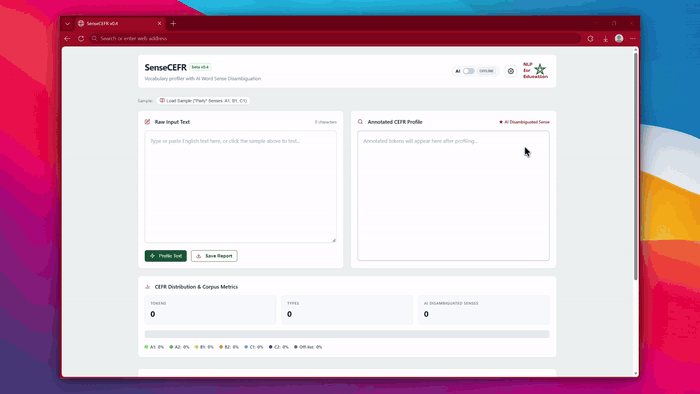

# SenseCEFR: Context-Aware Vocabulary Profiler with AI Word Sense Disambiguation

<p align="center">
  
</p>

<p align="center">
  <strong>A data-driven CEFR vocabulary profiler that solves the <em>Polysemy Flatline Problem</em> by disambiguating word senses (A1 to C2) in context.</strong>
</p>

<p align="center">
  <a href="LICENSE.txt"></a>
  <a href="https://doi.org/10.5281/zenodo.23318092"></a>
  <a href="https://github.com/NLP4Ed/SenseCEFR"></a>
  <a href="https://nlp4ed.com/SenseCEFR/"></a>
  <a href="index.html"></a>
</p>

---

## Quick Demo

<p align="center">
  
</p>

<p align="center">
  <a href="https://youtu.be/xxs5WI3Yi8s" target="_blank" rel="noopener noreferrer">
     Watch on YT
  </a>
</p>

---

## The Problem: The "Polysemy Flatline"

Standard CEFR text profilers (such as VocabKitchen or conventional wordlist matchers) assign each word a static difficulty level based solely on lemma frequency. This creates the **Polysemy Flatline**: polysemous words are systematically flattened to their lowest, beginner level regardless of how they are used.

Consider how the word **party** shifts difficulty across contexts:

| Sentence Context | Traditional Profiler | SenseCEFR (Context-Aware) | Actual Pedagogical Meaning |
| :--- | :---: | :---: | :--- |
| *"We celebrated at a wonderful birthday **party** with my best friends."* | **A1** | **A1** | Social celebration |
| *"Both political **parties** debated the election campaign vigorously."* | **A1** *(Incorrect)* | **B1** | Political organization |
| *"The binding contract was formally signed by each legal **party**."* | **A1** *(Incorrect)* | **C1** | Legal entity / contracting body |

By misclassifying advanced academic or legal senses as beginner vocabulary, traditional tools severely underestimate the true linguistic difficulty of textbooks, graded readers, examinations, and student essays.

---

## How SenseCEFR Solves It

SenseCEFR analyzes entire sentences to identify multi-tier polysemous tokens and resolves their exact CEFR level (A1 to C2) through a two-tier hybrid architecture:

```
                       Input Text
                           │
             [Tokenizer & Sentence Splitter]
                           │
             [Rule-Based Lemmatization]
             (O(1) inflection map + suffix heuristics)
                           │
             [Polysemy Discrepancy Gate]
             Does lemma span multiple CEFR levels?
                    /             \
                  NO               YES (15-20% of tokens)
                  │                 │
           [Direct Lookup]   [Word Sense Disambiguation]
           (0ms, instant)    • Local Context Matcher (Built-in)
                             • Google Gemini AI Contextual Reasoning
                                    │
                       [CEFR Level Tier Assignment]
                       (A1, A2, B1, B2, C1, C2)
                                    │
                       [Click-to-Inspect Modal]
                       • Guideword & Sense Definition
                       • Candidate sense levels & Confidence score
                       • Manual level selection with live recalculation
```

---

## Key Features

### 1. Accurate Multi-Tier Profiling (A1 to C2)
* Evaluates tokens across the CEFR scale: **A1**, **A2**, **B1**, **B2**, **C1**, and **C2**.
* **Off-list**: Terms outside the pedagogical corpus are clearly distinguished.
* **Unresolved Senses**: Ambiguous or unmapped senses are flagged with `⚑` for immediate pedagogical review.

### 2. Context-Aware Sense Marker (`✦`)
Tokens whose difficulty level was adjusted through word sense disambiguation are marked with `✦` so educators and linguists can easily identify where context altered the vocabulary tier.

### 3. Interactive Word Inspector Modal
Click any profiled token to open the Word Inspector:
* View the active dictionary definition, guideword, and assigned CEFR tier.
* Inspect context confidence scores (e.g. `98% Context Match`).
* Review rejected candidate senses with the option to click **✓ Select this Sense** to manually override the level. All profile metrics and distributions update in real time.

### 4. Custom Lexicon & Curriculum Manager
Open **Settings** (gear icon) to access the built-in lexicon customization center:
* **Single Word Overrides**: Assign custom CEFR levels to emerging or domain-specific terminology (e.g. `blockchain` → `C1`).
* **Multi-Sense Polysemy**: Define multiple senses for a single word with distinct CEFR tiers, parts of speech, guidewords, and definitions. Both the local matcher and Gemini AI will automatically disambiguate between them.
* **CSV Import & Backup**: Bulk import vocabulary lists directly from Excel/Google Sheets, export timestamped backups, or reset to factory defaults with 1 click.

### 5. Google Gemini AI Integration
Optionally connect your Google Gemini API key (e.g., `gemini-flash-lite-latest`) for:
* Zero-shot deep reasoning on complex figurative, idiomatic, and metaphorical usage.
* Plain-English pedagogical rationales explaining why a sense was selected.

### 6. One-Click Spreadsheet Reports
Click **Save Report** to generate a comprehensive CSV report containing token counts, type-token ratios, CEFR distributions, and a complete audit log of all disambiguated polysemous words.

---

## Lexical Coverage

SenseCEFR harmonizes multiple academic corpora:
* **8,889 total headwords** (CEFR-J 1.5, Octanove C1/C2, WordNet-CEFR, and Academic Word List overlay).
* **1,206 polysemous multi-CEFR words** with **3,936 distinct sense definitions and contextual collocation vectors**.
* **105 phrasal verb constructions** (e.g., *bank on*, *figure out*, *look after*, *carry out*).
* **32,013 inflection-to-lemma pairings** for instant $O(1)$ morphological resolution.

---

## Quick Start

### Option 1: Live Web Application
Access the profiler directly in your web browser:
[**https://nlp4ed.com/SenseCEFR/**](https://nlp4ed.com/SenseCEFR/)

### Option 2: Offline Local Execution
Download the source code as a ZIP (or clone this repository) and open **[`index.html`](index.html)** in any web browser:
```bash
git clone https://github.com/NLP4Ed/SenseCEFR.git
cd SenseCEFR
```

---

## Citation

If you use SenseCEFR in academic research, textbook leveling, or curriculum design, please cite it using [`CITATION.cff`](CITATION.cff) or the following BibTeX entry:

```bibtex
@software{sensecefr2026,
  author       = {Lchgary, Yassine},
  title        = {SenseCEFR: Context-Aware Vocabulary Profiler with Word Sense Disambiguation},
  year         = {2026},
  version      = {0.4.2},
  doi          = {10.5281/zenodo.23318092},
  url          = {https://nlp4ed.com/SenseCEFR/}
}
```

---

## Attribution

SenseCEFR is built upon several foundational open-source datasets, academic lexical databases, and natural language processing research.

### Datasets

1. **CEFR-Annotated WordNet** (Kikuchi et al.)
   * **Role**: Primary data source for sense-level CEFR proficiency annotations mapped across WordNet synsets.
   * **License**: [CC BY 4.0](https://creativecommons.org/licenses/by/4.0/)
   * **Resource**: [Hugging Face Dataset](https://huggingface.co/datasets/star092304/CEFR-Annotated-WordNet)

2. **Princeton WordNet 3.0 & Morphy** (Miller et al.)
   * **Role**: English lexical database providing synset definitions and glosses, plus Morphy morphological exception tables (`*.exc`) for client-side irregular lemmatization.
   * **License**: [WordNet 3.0 License](https://wordnet.princeton.edu/license-and-commercial-use) (Permissive, Copyright 2006 Princeton University)
   * **Resource**: [Princeton WordNet](https://wordnet.princeton.edu/)

3. **CEFR-J Lexical Database (v1.5)** (Tokyo University of Foreign Studies)
   * **Role**: Core graded vocabulary framework providing baseline A1–B2 word-family proficiency targets.
   * **License**: Open Educational / Academic Citation
   * **Resource**: [CEFR-J Project](http://www.cefr-j.org/) · [Open Language Profiles CEFR-J](https://github.com/openlanguageprofiles/olp-en-cefrj)

4. **Octanove C1/C2 Vocabulary Profiles** (Octanove Labs)
   * **Role**: Advanced lexical profiles extending SenseCEFR coverage to C1 and C2 proficiency levels.
   * **License**: [CC BY-SA 4.0](https://creativecommons.org/licenses/by-sa/4.0/)
   * **Resource**: [Open Language Profiles (CEFR-J & Octanove)](https://github.com/openlanguageprofiles/olp-en-cefrj)

5. **Oxford 3000™ / 5000™ Wordlists** (Oxford University Press)
   * **Role**: Graded frequency wordlists, pedagogical definitions, and guidewords used to benchmark learner dictionary senses against WordNet synsets.
   * **Terms**: Oxford 3000™ and Oxford 5000™ are trademarks of Oxford University Press (referenced for academic comparison).
   * **Resource**: [Oxford Learner's Dictionaries Wordlists](https://www.oxfordlearnersdictionaries.com/wordlists/oxford3000-5000)

6. **CEFR Illustrative Descriptors & Companion Volume** (Council of Europe)
   * **Role**: International reference standard defining the 6-level proficiency scale (A1–C2), illustrative descriptors, and communicative proficiency criteria.
   * **Terms**: Official International Standard (Council of Europe, referenced for educational alignment)
   * **Resource**: [Council of Europe CEFR Portal](https://www.coe.int/en/web/common-european-framework-reference-languages)

7. **Mihalcea WSD Corpora & Resources** (Rada Mihalcea)
   * **Role**: Word Sense Disambiguation evaluation benchmarks and methodology used to calibrate the contextual window overlap scorer.
   * **Terms**: Academic & Research Use
   * **Resource**: [University of Michigan WSD Downloads](https://web.eecs.umich.edu/~mihalcea/downloads.html)

---

### Papers & Preprints

1. **CEFR-Annotated WordNet**:  
   Kikuchi, M., Ono, M., Soga, T., Tanabe, T., & Ozono, T. (2024). *CEFR-Annotated WordNet: LLM-Based Proficiency-Guided Semantic Database for Language Learning*. arXiv preprint arXiv:2510.18466. [https://doi.org/10.48550/arXiv.2510.18466](https://doi.org/10.48550/arXiv.2510.18466)

2. **Princeton WordNet**:  
   Miller, G. A. (1995). *WordNet: A lexical database for English*. Communications of the ACM, 38(11), 39–41. [https://doi.org/10.1145/219717.219748](https://doi.org/10.1145/219717.219748)

3. **CEFR-J Framework**:  
   Negishi, M., Takada, T., & Tono, Y. (2013). *A progress report on the development of the CEFR-J*. In N. Saville & F. Sheehan (Eds.), *Critical issues in language testing: Studies in language testing* (Vol. 36, pp. 135–163). Cambridge University Press. [http://www.cefr-j.org/](http://www.cefr-j.org/)

4. **CEFR Companion Volume**:  
   Council of Europe. (2001, 2020). *Common European Framework of Reference for Languages: Learning, teaching, assessment – Companion volume*. Council of Europe Publishing. [https://www.coe.int/en/web/common-european-framework-reference-languages](https://www.coe.int/en/web/common-european-framework-reference-languages)

5. **Simplified Lesk Algorithm (WSD)**:  
   Lesk, M. (1986). *Automatic sense disambiguation using machine-readable dictionaries: How to tell a pine cone from an ice cream cone*. In *Proceedings of the 5th Annual International Conference on Systems Documentation (SIGDOC '86)* (pp. 24–26). Association for Computing Machinery. [https://doi.org/10.1145/318723.318728](https://doi.org/10.1145/318723.318728)

6. **Wikipedia-Based Sense Disambiguation**:  
   Mihalcea, R. (2007). *Using Wikipedia for automatic word sense disambiguation*. In *Human Language Technologies 2007: NAACL-HLT Companion Volume* (pp. 197–200). Association for Computing Machinery. [https://web.eecs.umich.edu/~mihalcea/downloads.html](https://web.eecs.umich.edu/~mihalcea/downloads.html)

---

## License

This project is licensed under the [MIT License](LICENSE.txt).
